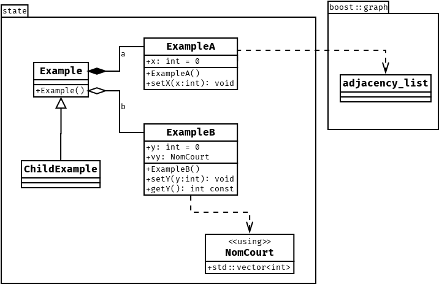

# PLT

[](https://github.com/cbares/plt/actions)

## Dépendances:

```console
sudo apt install libboost-all-dev
```

## Mise à jour depuis le template:

* __Si__ votre dépôt __ne dépend pas__ du template:
```console
git remote add template https://github.com/cbares/plt
```

* Ensuite:
```console
git fetch --all
```

* puis récupérer les fichiers importants: 
```console
git checkout template/master CMakeLists.txt extern/dia2code
```

## nouveautés

* gère les alias cpp avec `using`:


